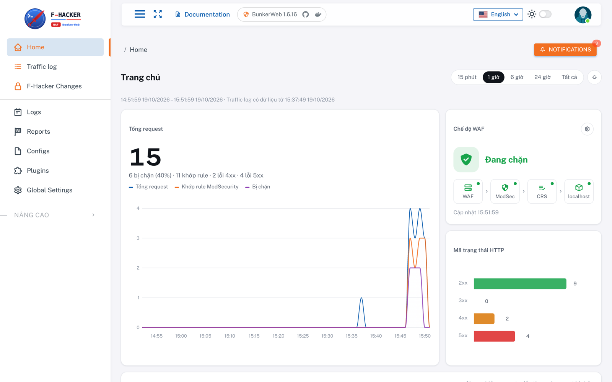
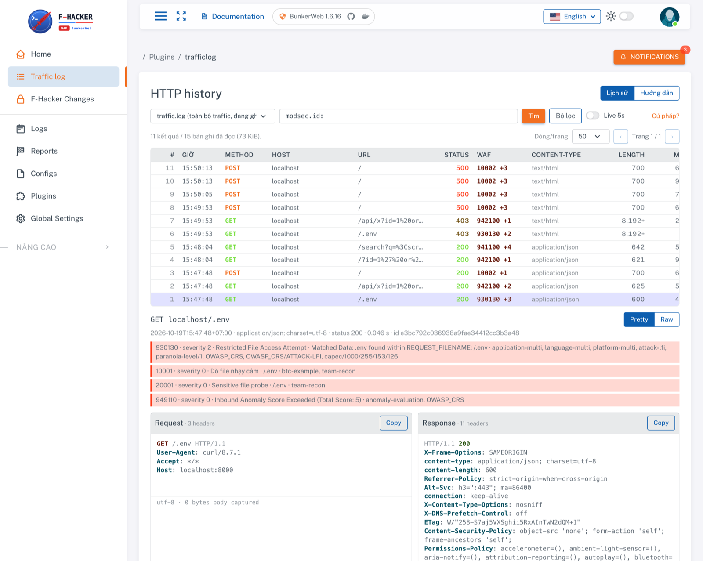

<p align="center">
  
</p>

<h3 align="center">WAF F-Hacker 2026 · bản tập</h3>

<p align="center">
  <a href="https://github.com/bunkerity/bunkerweb/releases/tag/v1.6.16"></a>
  <a href="https://github.com/f-hacker-macos/2026-waf-practice/pkgs/container/custom_waf26"></a>
  
  <a href="https://docs.bunkerweb.io/1.6.16/"></a>
</p>

Dựng **đúng image WAF dùng lúc thi** trên máy bạn để làm quen và tập viết rule trước.
Phía sau WAF là một app echo trả lại request của bạn, không phải app thi.



> **Chỉ custom giao diện, không custom core.** Đây là BunkerWeb 1.6.16 nguyên bản; BTC thêm giao
> diện F-Hacker, plugin Traffic log và giá trị mặc định. nginx, ModSecurity, CRS giữ nguyên, nên
> [tài liệu chính thức](https://docs.bunkerweb.io/1.6.16/) đúng hoàn toàn. Chi tiết: [docs/btc-custom.md](docs/btc-custom.md).

## Phiên bản

| | |
|---|---|
| Image | [`ghcr.io/f-hacker-macos/custom_waf26:1.0.0`](https://github.com/f-hacker-macos/2026-waf-practice/pkgs/container/custom_waf26) (`linux/amd64`) |
| Dựng trên | [`bunkerity/bunkerweb-all-in-one:1.6.16`](https://hub.docker.com/r/bunkerity/bunkerweb-all-in-one) · [release v1.6.16](https://github.com/bunkerity/bunkerweb/releases/tag/v1.6.16) |
| Tài liệu gốc | [Tổng quan](https://docs.bunkerweb.io/1.6.16/) · [Web UI](https://docs.bunkerweb.io/1.6.16/web-ui/) · [ModSecurity](https://docs.bunkerweb.io/1.6.16/features/#modsecurity) · [Custom configurations](https://docs.bunkerweb.io/1.6.16/advanced/#custom-configurations) · [Plugins](https://docs.bunkerweb.io/1.6.16/plugins/) |

## Chạy

Cần Docker (Desktop hoặc Engine + Compose v2), khoảng 3 GB RAM trống, và `make`
(Windows: dùng WSL hoặc [chạy tay](#không-có-make)). Máy Apple Silicon chạy image amd64 qua giả lập, chậm hơn.

```bash
make up
```

Lần đầu mất khoảng 1-2 phút (tải image, BunkerWeb tạo database, seed). Xong:

| | Địa chỉ | Đăng nhập |
|---|---|---|
| App qua WAF | http://localhost:8000/ | |
| WAF UI | http://localhost:8005/ | `admin` / `ChangeMe_Bw_2026!` |

Đổi cổng hoặc mật khẩu: sửa `.env` (tạo từ `.env.example` ở lần `make up` đầu), rồi `make up` lại.

## Thử nhanh

```bash
curl -i 'http://localhost:8000/?id=1%27%20or%201=1'             # CRS đánh dấu SQLi
curl -i -X POST http://localhost:8000/ -d 'note=FHACKER{demo}'  # body quay lại trong response
```

Mở WAF UI → **Traffic log** để xem từng request và rule nào khớp. Mặc định ModSecurity ở
`DetectionOnly`: chỉ ghi log, chưa chặn.



## Tài liệu

| | |
|---|---|
| [docs/huong-dan.md](docs/huong-dan.md) | Luồng request, thứ tự nạp custom config, viết rule ModSecurity, gỡ false positive, test, bật chặn |
| [docs/btc-custom.md](docs/btc-custom.md) | BTC đã đổi gì so với BunkerWeb gốc, setting nào bị khoá và vì sao |

## Lệnh

```bash
make up      # dựng / cập nhật
make seed    # seed lại cấu hình BTC (không đè cấu hình bạn sửa)
make pull    # tải bản image mới nhất, rồi make up
make down    # dừng, giữ cấu hình và log
make reset   # xoá sạch cấu hình WAF và log
make logs    # log BunkerWeb
```

## Không có make

```bash
cp .env.example .env
docker compose up -d
# chờ ~1 phút, rồi seed (team_user = ADMIN_USERNAME trong .env):
R=$(docker compose exec -T fuap_bunkerweb cat /usr/share/fhacker/rules/mau-rule-phong-thu.conf)
docker compose exec -T fuap_bunkerweb cat /usr/share/fhacker/bunkerweb-seed.sql | \
  docker compose exec -T postgres psql -U bunkerweb -d bunkerweb \
  -v team_user=admin -v team_pw=unused -v team_rule="$R"
docker compose up -d --no-deps --force-recreate fuap_bunkerweb
```

---

BunkerWeb © [Bunkerity](https://www.bunkerity.com/), giấy phép [AGPL-3.0](https://github.com/bunkerity/bunkerweb/blob/v1.6.16/LICENSE.md).
