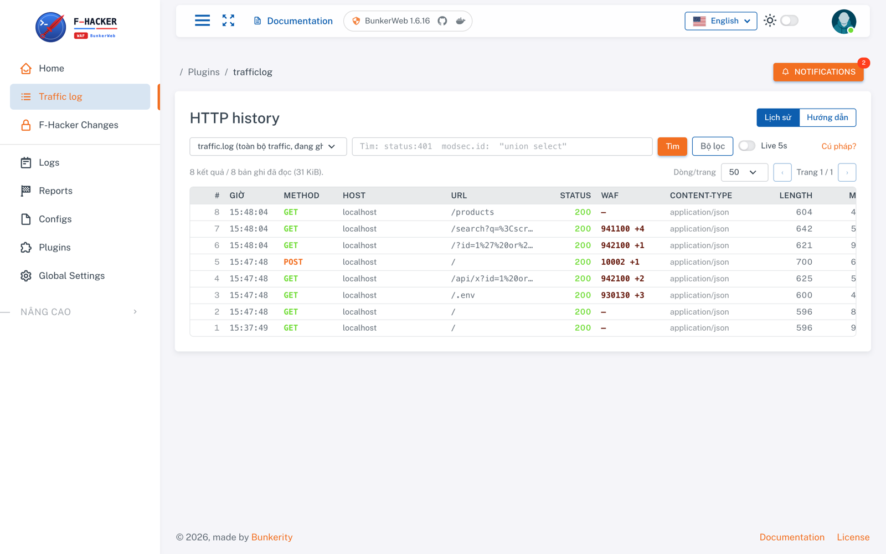

# BTC đã custom những gì

`custom_waf26` là **BunkerWeb 1.6.16 nguyên bản** (`bunkerity/bunkerweb-all-in-one:1.6.16`),
BTC chỉ thêm giao diện, một plugin và giá trị mặc định. **Không sửa core**: nginx, ModSecurity,
OWASP CRS v4, scheduler và cách BunkerWeb sinh cấu hình giữ nguyên, nên mọi thứ trong
[tài liệu chính thức 1.6.16](https://docs.bunkerweb.io/1.6.16/) đều đúng với bản này.

## Giao diện

- Logo, màu, tiếng Việt làm ngôn ngữ mặc định (đổi ở thanh trên), **Home** mới với số liệu từ Traffic log.
- Menu gọn lại: các trang ít dùng (Services, Templates, Instances, Jobs, Cache, Bans, Support) nằm trong
  nhóm thu gọn ở cuối sidebar; Errors, Miscellaneous, Whitelist,
  Blacklist ẩn khỏi menu nhưng vẫn mở được qua URL.
- Trang **F-Hacker Changes** liệt kê chi tiết mọi thay đổi và các chức năng bị tắt kèm lý do.
- Editor của **Configs** tô màu cú pháp cho loại `MODSEC`/`MODSEC_CRS` (bản gốc hiện chữ trơn).

## Plugin Traffic log (thêm mới)

Trang **Traffic log** xem lịch sử request kiểu Burp: request/response đầy đủ, tìm kiếm, lọc thời
gian, và cột **WAF** cho biết rule ModSecurity nào khớp với từng request. Log nằm ở
`/var/log/bunkerweb/traffic.log` trong container; body request giữ tối đa 16 KiB, response 8 KiB.
Cách dùng chi tiết: mục **Hướng dẫn** ngay trong trang.

## Giá trị mặc định

| Nhóm | Setting | Giá trị | Sửa được? |
|---|---|---|---|
| Bật sẵn (seed) | `USE_MODSECURITY`, `USE_MODSECURITY_CRS` | `yes` | Có |
| | `MODSECURITY_SEC_RULE_ENGINE` | `DetectionOnly` (chỉ ghi log, chưa chặn) | Có |
| | `MODSECURITY_SEC_AUDIT_ENGINE` / `..._LOG_PARTS` | `RelevantOnly` / `BCEFH` | Có |
| | `USE_BLACKLIST` | `no` | Có |
| | `LOG_FORMAT` | rút gọn, có thời gian xử lý và Content-Type | Có |
| Khoá (đặt bằng env) | `USE_BAD_BEHAVIOR`, `USE_LIMIT_REQ`, `USE_LIMIT_CONN`, `USE_DNSBL` | `no` | Không |
| | `USE_BUNKERNET`, `BLACKLIST_COMMUNITY_LISTS`, `USE_MODSECURITY_CRS_PLUGINS` | tắt | Không |
| | `AUTO_REDIRECT_HTTP_TO_HTTPS` | `no` | Không |

Vì sao khoá: lúc thi mọi request tới WAF đi qua **một IP proxy của BTC**, nên chặn hoặc giới hạn
theo IP sẽ chặn luôn bot chấm điểm. Máy thi cũng không có Internet, nên các danh sách cộng đồng và
CRS plugins tải từ mạng không dùng được.

Hệ quả của `USE_MODSECURITY_CRS_PLUGINS=no`: config loại `CRS_PLUGINS_BEFORE` và `CRS_PLUGINS_AFTER`
**không được nạp**. Dùng `MODSEC_CRS` (trước CRS) và `MODSEC` (sau CRS) thay thế, xem
[huong-dan.md](huong-dan.md#1-tổng-quan).

Rule mẫu `mau-rule-phong-thu` (**Configs**, loại `MODSEC`) được tạo sẵn để tham khảo; sửa, đổi tên hay xoá đều được.

## Khác giữa bản tập và lúc thi

| | Bản tập | Lúc thi |
|---|---|---|
| Phía sau WAF | App echo trả lại request | App thi của đội |
| Tài khoản | Một tài khoản admin trong `.env` | BTC cấp tài khoản cho từng đội |
| Image, setting, plugin | Giống nhau | Giống nhau |
