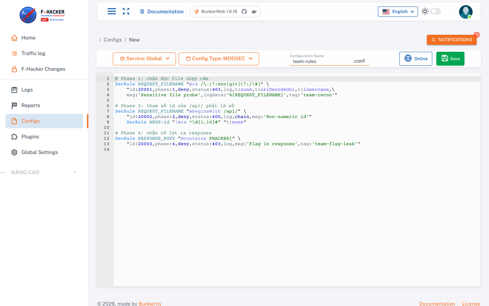
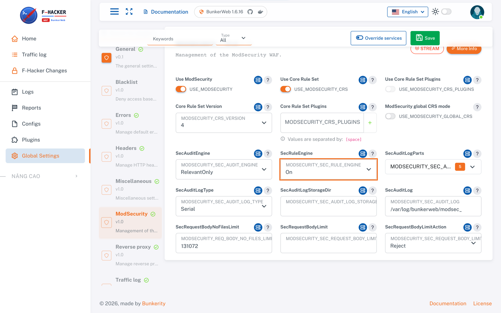

# Custom config và test WAF

Tài liệu kỹ thuật cho bản tập `custom_waf26:latest` (BunkerWeb 1.6.16, ModSecurity v3, OWASP CRS v4).
Tham chiếu đầy đủ: [docs.bunkerweb.io/1.6.16](https://docs.bunkerweb.io/1.6.16/).

UI mặc định tiếng Việt. Tài liệu dùng tên menu tiếng Anh; đổi ngôn ngữ ở thanh trên nếu cần.

| Menu (EN) | Tiếng Việt | Dùng để |
|---|---|---|
| Home | Trang chủ | Trạng thái, chế độ WAF |
| Traffic log | Traffic log | Lịch sử request/response, rule khớp |
| Configs | Cấu hình | Custom config (ModSecurity, nginx) |
| Global Settings | Cài đặt chung | Setting của từng module |
| Plugins | Plugin | Upload plugin |
| Logs | Log | File log thô (`access.log`, `error.log`, ...) |

## 1. Tổng quan

```
client → BunkerWeb (nginx + ModSecurity v3 + CRS v4) → app echo
```

- `MODSECURITY_SEC_RULE_ENGINE` mặc định `DetectionOnly`: rule khớp chỉ ghi log, chưa chặn.
- CRS chặn theo tổng điểm bất thường (rule `949110`), không theo từng rule riêng lẻ.
- Custom config `MODSEC` nạp **sau** CRS, `MODSEC_CRS` nạp **trước** CRS; `HTTP`/`SERVER_HTTP` là cấu hình nginx.
- `CRS_PLUGINS_BEFORE`/`CRS_PLUGINS_AFTER` **không được nạp** (BTC khoá `USE_MODSECURITY_CRS_PLUGINS=no`).
- Log nằm ở `/var/log/bunkerweb/` trong container (`traffic.log`, `modsec_audit.log`, `error.log`).

Chi tiết: [ModSecurity](https://docs.bunkerweb.io/1.6.16/features/#modsecurity),
[Custom configurations](https://docs.bunkerweb.io/1.6.16/advanced/#custom-configurations).

## 2. Tạo custom config

**Configs** → nút tạo mới → **Service**: `Global`, **Config Type**: `MODSEC` → đặt tên (`.conf` tự thêm)
→ dán nội dung → **Save**.



Sau khi lưu, scheduler ghi file vào `/etc/bunkerweb/configs/<type>/<tên>.conf`, sinh lại cấu hình nginx,
chạy `nginx -t` rồi reload (vài giây). Sai cú pháp thì giữ cấu hình đang chạy và báo lỗi ở chuông thông báo.
Kiểm tra file đã nạp:

```bash
docker compose exec fuap_bunkerweb ls /etc/bunkerweb/configs/modsec/
docker compose exec fuap_bunkerweb grep -i "modsec\|emerg" /var/log/bunkerweb/error.log | tail
```

### Ví dụ

```apache
# Phase 1: chặn đọc file nhạy cảm
SecRule REQUEST_FILENAME "@rx /\.(?:env|git)(?:/|$)" \
    "id:20001,phase:1,deny,status:403,log,t:none,t:urlDecodeUni,t:lowercase,\
    msg:'Sensitive file probe',logdata:'%{REQUEST_FILENAME}',tag:'team-recon'"

# Phase 2: tham số id của /api/ phải là số
SecRule REQUEST_FILENAME "@beginsWith /api/" \
    "id:20002,phase:2,deny,status:400,log,chain,msg:'Non-numeric id'"
    SecRule ARGS:id "!@rx ^\d{1,10}$" "t:none"

# Phase 4: chặn cờ lọt ra response
SecRule RESPONSE_BODY "@contains FHACKER{" \
    "id:20003,phase:4,deny,status:403,log,msg:'Flag in response',tag:'team-flag-leak'"
```

- `id` duy nhất trong toàn bộ cấu hình; dùng từ `20000` (CRS dùng `9xxxxx`, BunkerWeb dùng `200000+`,
  rule mẫu dùng `10000-10099`).
- Transformation (`t:`) chạy trước operator: luôn bắt đầu bằng `t:none`, rồi thêm `urlDecodeUni`,
  `lowercase`, `htmlEntityDecode`, `normalizePath`... tuỳ dữ liệu.
- `chain`: chỉ rule đầu có `id`, `phase` và action disruptive; các rule sau chỉ có điều kiện.
- `msg`, `tag`, `logdata` hiện trong Traffic log và audit log, nên đặt rõ để tìm lại.

### Gỡ false positive của CRS

```apache
# MODSEC (sau CRS): gỡ cả rule, hoặc bỏ một biến khỏi rule
SecRuleRemoveById 920350
SecRuleUpdateTargetById 942440 "!REQUEST_COOKIES:session"
```

```apache
# MODSEC_CRS (trước CRS): bỏ rule theo route bằng ctl
SecRule REQUEST_FILENAME "@streq /api/notes" \
    "id:20100,phase:1,pass,nolog,t:none,ctl:ruleRemoveTargetById=941100;ARGS:content"
```

Rule exclusion phải chạy **trước** rule bị gỡ, nên `ctl:` theo request đặt ở `MODSEC_CRS`;
`SecRuleRemoveById`/`SecRuleUpdateTargetById` sửa rule đã nạp nên đặt ở `MODSEC`.

## 3. Test

```bash
curl -s -o /dev/null -w '%{http_code}\n' 'http://localhost:8000/.env'
curl -s -o /dev/null -w '%{http_code}\n' 'http://localhost:8000/api/x?id=1%20or%201=1'
curl -s -o /dev/null -w '%{http_code}\n' -X POST http://localhost:8000/ -d 'note=FHACKER{demo}'
```

Kết quả đo trên bản tập với 3 rule ví dụ:

| Request | `DetectionOnly` | `On` |
|---|---|---|
| `GET /.env` | `200`, khớp 930130, 20001, 949110 | `403` |
| `GET /api/x?id=1 or 1=1` | `200`, khớp 942100, 20002 | `403`: CRS (949110) chặn ở phase 2 trước, vì `MODSEC` nạp sau CRS; 20002 không kịp chạy |
| `POST / note=FHACKER{demo}` | `200`, khớp 20003 | Client nhận header `200` nhưng body rỗng, kết nối bị đóng (`curl: (18) transfer closed`); Traffic log ghi `500` |

Phase 4 chạy khi header response đã gửi đi, nên `deny` không đổi được status code: nginx cắt body và
đóng kết nối (`header already sent` trong `error.log`). Cờ vẫn không lọt ra, nhưng đừng chờ `403`.

**Traffic log**: mỗi request một dòng, cột **WAF** là id rule khớp (gắn từ `modsec_audit.log` qua
`request_id`). Bấm vào dòng để xem rule, request và response:


Cú pháp tìm:

| Truy vấn | Ý nghĩa |
|---|---|
| `modsec.id:20001` | Khớp rule 20001 |
| `modsec.id:` | Khớp ít nhất một rule |
| `modsec.tag:attack-sqli` | Theo tag (rule CRS có tag `attack-*`) |
| `status:4xx` | Mã trạng thái 400-499 |
| `method:POST /login` | Kết hợp field và text |

Audit log thô:

```bash
docker compose exec fuap_bunkerweb tail -n 1 /var/log/bunkerweb/modsec_audit.log | python3 -m json.tool
```

## 4. Bật chặn

**Global Settings** → **ModSecurity** → `MODSECURITY_SEC_RULE_ENGINE` = `On` → **Save**
(hoặc nút **Bật chặn** trên **Home**). Chỉ có tác dụng khi `SECURITY_MODE=block` (mặc định).



Quy trình nên dùng: viết rule với `pass,log` → gửi cả request tấn công lẫn request bình thường →
kiểm tra Traffic log không khớp nhầm → đổi sang `deny` → bật `On`.

## 5. Plugin

**Plugins** → upload ZIP chứa thư mục plugin (`plugin.json` + Lua/Jinja). Cấu trúc và API:
[Plugins](https://docs.bunkerweb.io/1.6.16/plugins/).
